<p align="center">
  
</p>

<p align="center">
  <b>Give <a href="https://hermes-agent.nousresearch.com">Hermes Agent</a> the senses of your own Android phone.</b><br>
  Notifications, SMS, UPI money, a live scam tripwire and find my phone, through Termux:API.<br>
  Hermes asks before it sends anything.
</p>

<p align="center">
  <a href="https://github.com/LSUDOKO/Phone-Senses/actions/workflows/tests.yml"></a>
  
  
  
  
  
  <a href="LICENSE"></a>
</p>

<p align="center">
  <a href="https://phone-senses.pages.dev"><b>Website</b></a> ·
  <a href="#setup">Install</a> ·
  <a href="#see-it-work">See it work</a> ·
  <a href="#privacy-and-disclosures">Privacy</a>
</p>

---

- **No screen tapping.** Each question is one Android API call, not 15 screenshots and taps.
- **Your own phone, your own SIM.** No cloud phone numbers, no third-party services.
- **Safe by design.** Signed requests, approval for every send, OTPs hidden, no SMS text stored.
- **Catches a scam while it happens.** The scam tripwire links an unsaved caller, a screen-sharing app,
  an OTP and money leaving, then warns you out loud on the phone. [How it works ↓](#scam-tripwire)

> *phone-harness gives Hermes hands on your phone. Phone Senses gives it the phone's senses.*

## See it work
Every clip is a **real Hermes Agent session**, step by step. Left: Hermes exactly as it looked in the
terminal, in its own colours. Right: the phone, recorded at the same moment. Steps along the top show
where you are: you ask, Hermes reads the phone, Hermes asks first (when it would act), the answer.

- **REAL PHONE:** a moto g34 (Android 15) over Termux:API. Phone numbers, amounts and other people's
  names are blurred. Texts marked **RE-CREATED** were sent to my own number for the demo.
- **DEMO PHONE:** bills and subscriptions ran on the built-in mock helper (I had no real bills that week).

### Morning brief


### Scam tripwire: a scam call caught while it happens
The "AnyDesk installed" signal is staged (a labelled test notification); the phone's spoken warning is real.
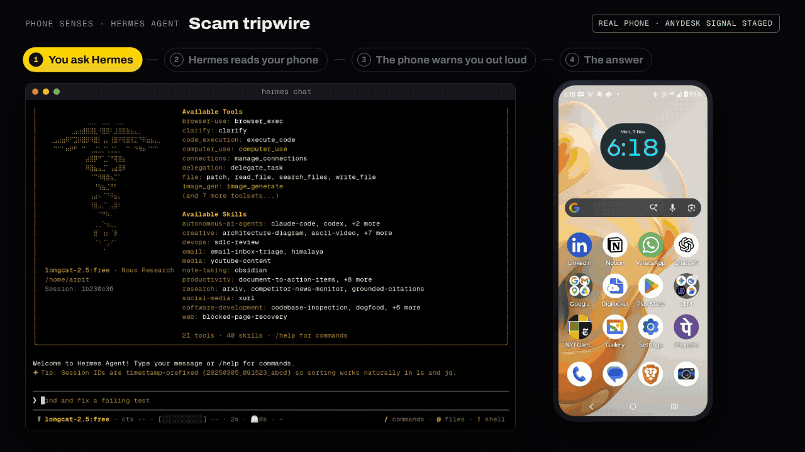

### It asks before it acts
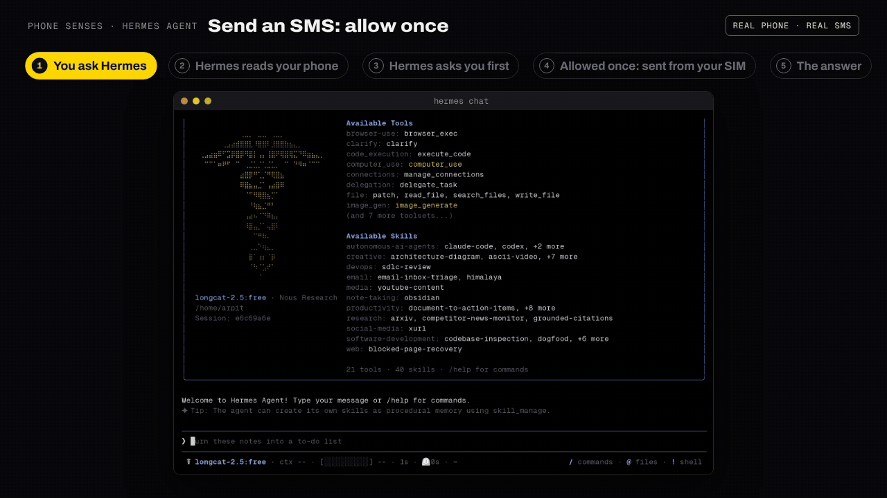
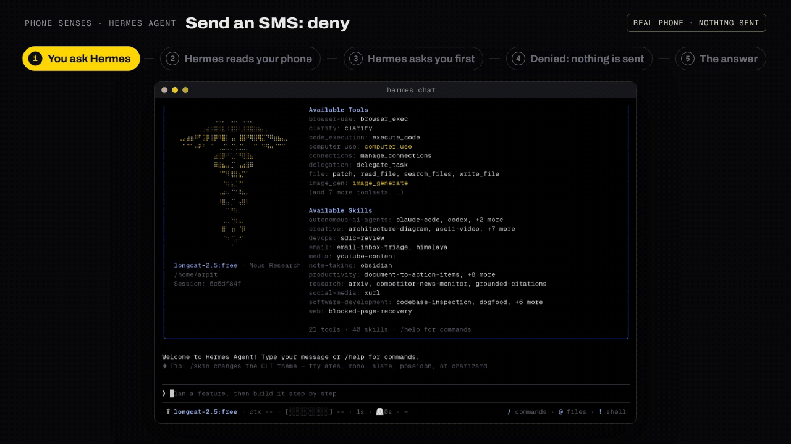

### Money from bank and UPI SMS
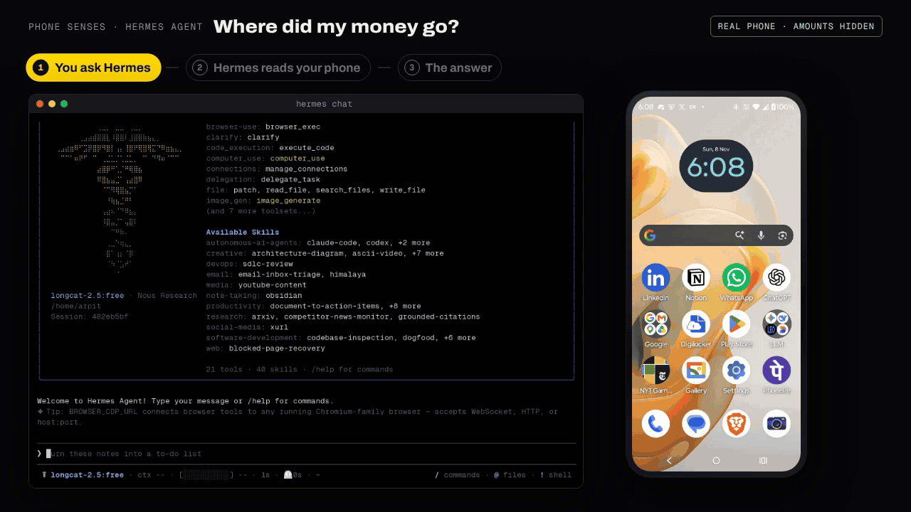


### Scam texts and one-time codes
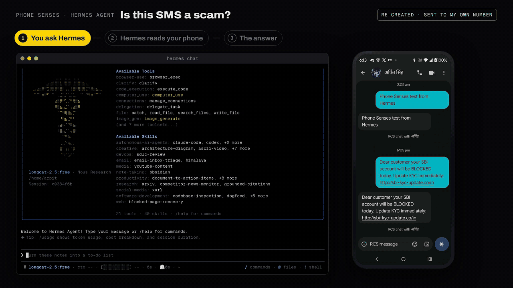
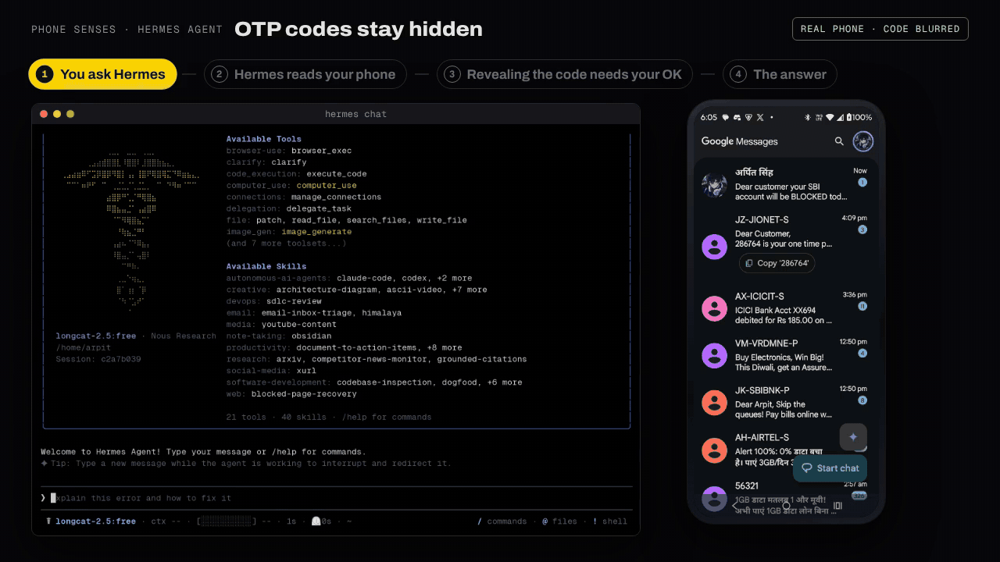

### Bills and subscriptions (demo phone)
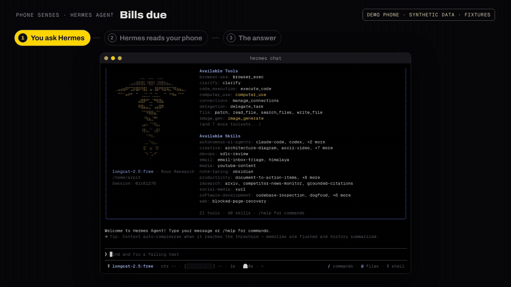
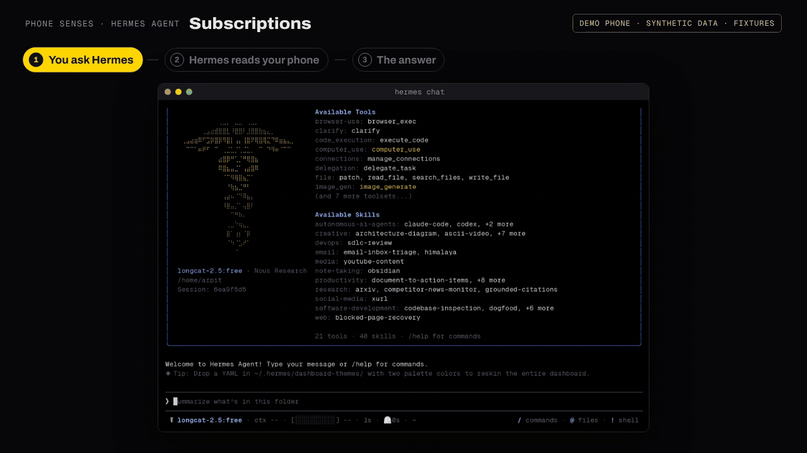

### Watch rules, battery and find my phone
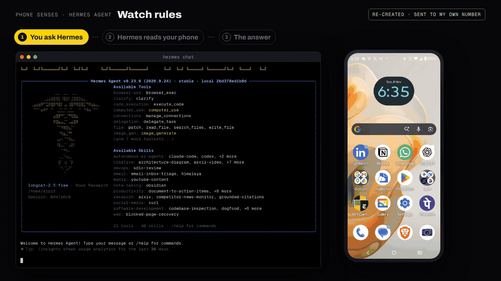
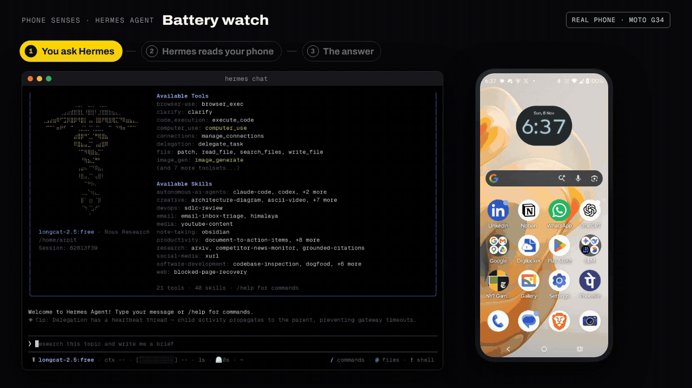
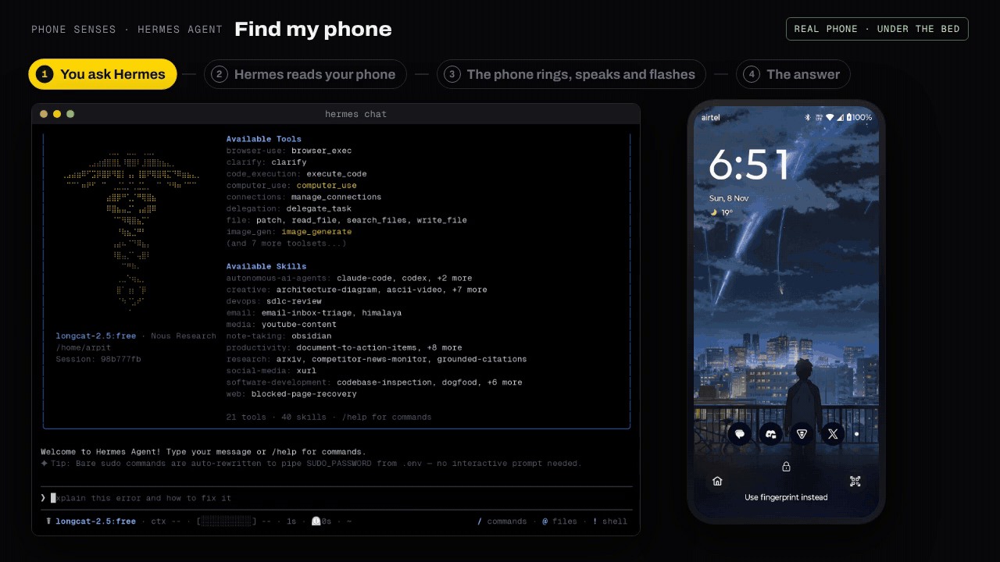

<details><summary><b>More real sessions</b>: calls, photos, unattended mode, speak, clipboard, location, the helper log</summary>

<table><tr>
<td width="50%">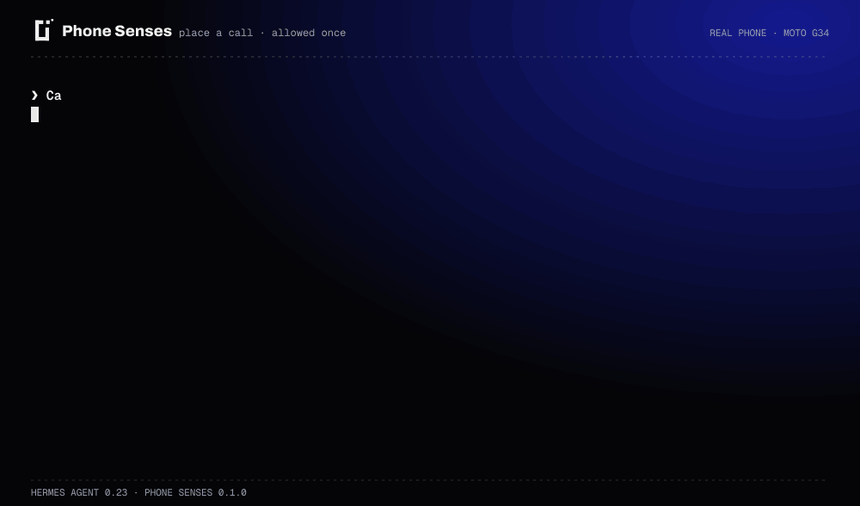<br><sub><b>real phone</b> · place a call</sub></td>
<td width="50%">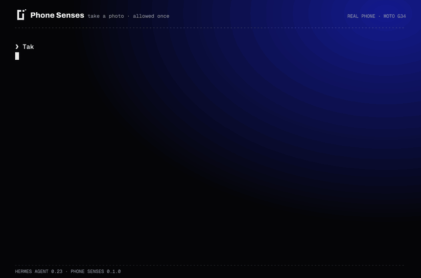<br><sub><b>real phone</b> · take a photo</sub></td>
</tr><tr>
<td width="50%">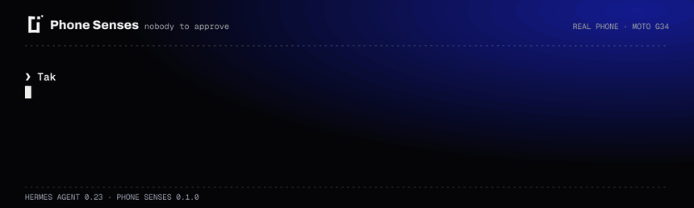<br><sub><b>real phone</b> · unattended (cron or <code>-q</code>): refused, nobody can approve</sub></td>
<td width="50%">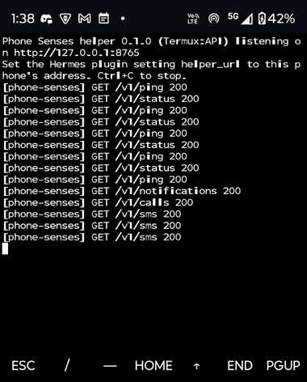<br><sub><b>real phone</b> · helper log: paths only, never message text</sub></td>
</tr><tr>
<td width="50%"><br><sub><b>real phone</b> · "Say 'dinner is ready' on my phone."</sub></td>
<td width="50%">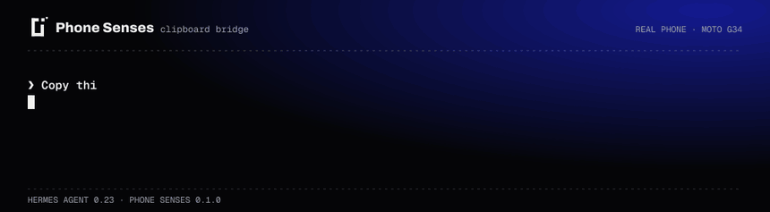<br><sub><b>real phone</b> · "Copy this link to my phone."</sub></td>
</tr><tr>
<td width="50%">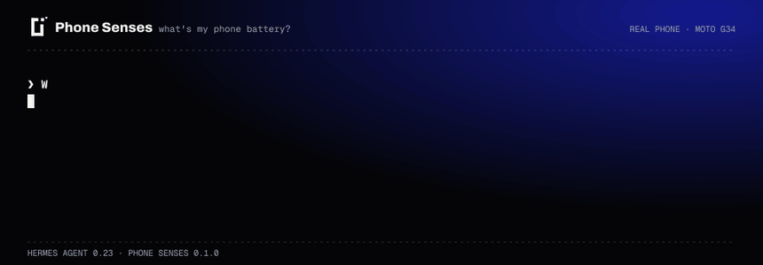<br><sub><b>real phone</b> · "What's my phone battery?"</sub></td>
<td width="50%">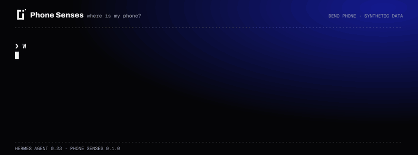<br><sub><b>demo phone</b> · "Where is my phone?"</sub></td>
</tr></table>
</details>

## Scam tripwire
Indian phone frauds ("KYC update", "digital arrest", fake bank support) follow a sequence, not a single
message. No single SMS looks bad enough, but the order and timing give the scam away:

```
unsaved caller (6 min)  →  "AnyDesk installed"  →  screen being shared  →  OTP SMS  →  ₹24,999 debited
        high                      high                    high              CRITICAL       CRITICAL
```

`phone_scam_guard` reads the last few minutes of calls, notifications, SMS and bank debits together and
returns a level (clear, low, high, critical), the timeline and plain advice: hang up, stop sharing,
decline the collect request, call **1930** (National Cyber Crime Helpline). With `alert_phone` the
phone shows a warning and says it out loud, right in the middle of the call. The OTP itself never
leaves the plugin.

- **On demand:** "Someone from my bank is on the phone, is this a scam?" or `/phone guard`.
- **Always on:** add a `scam_guard` watch rule and run `phone_watch_check` with `notify_phone` from a
  Hermes cron job every few minutes. Each incident alerts once, and again only if it escalates.
- **Try it without a scam:** `python phone_helper/helper.py --mock --mock-scenario scam` plays a full
  scam call in progress with synthetic data.

A screen-tapping agent only sees one screen at a time, and a single-message scam filter only sees one
SMS. The tripwire needs both history and every sensor at once, which is why it lives here.
Limits: the call log shows a call only after it ends, so during the call the warning comes from the
screen-sharing app, the OTP or the debit. Detection is rule-based: a warning, not a guarantee.

## What you can ask
| You say | What happens |
|---|---|
| "Anything important on my phone?" | A digest of notifications, missed calls and SMS. Noise is filtered out and OTPs are hidden. |
| "How much did I spend this week?" | A spending table by category, built from bank, card and UPI SMS |
| "How much did I receive by UPI today?" | Today's incoming payments: handy for shop owners |
| "Text Rahul I'm 10 minutes late" | Looks up Rahul. If there are two, it asks which one. Then Hermes shows an approval prompt with the exact number and text. |
| "Is this SMS a scam?" | A risk level and the reasons: fake KYC, disconnection threats, look-alike links |
| "A caller from my bank asked me to install AnyDesk" | The scam tripwire: the call, apps, codes and debits of the last minutes together, with a spoken warning on the phone |
| "Tell me when my order is out for delivery" | A watch rule. Run `phone_watch_check` from a Hermes cron job to get alerts. |
| "Find my phone" | The phone rings at full volume, speaks, vibrates and flashes. Then the volume is restored. |
| "What bills are due soon?" | Electricity, broadband, mobile and card bills found in your SMS, overdue ones first |
| "What subscriptions am I paying for?" | Recurring charges (Spotify, Netflix, …) with cadence, next expected date and the monthly total |
| "Where are my parcels?" | Latest status per shipment from courier and shop SMS: shipped, out for delivery, delivered |
| "Tell me when my battery drops below 20%" | A `battery_below` watch rule: one alert, re-armed after the phone charges |
| "Good morning, brief me" | Battery, missed calls, SMS from people, important notifications, scam alerts and yesterday's spending |
| "Where is my phone?" / "Read this aloud" / "Copy this link to my phone" | Location with a Maps link / text-to-speech / clipboard |

Slash command: `/phone`, `/phone ring`, `/phone money week`, `/phone received today`, `/phone brief`, `/phone pair`.

## Tools
| Tool | What it does | Approval |
|---|---|---|
| `phone_status` | Battery, charging, temperature, Wi-Fi, helper reachability | |
| `phone_notifications` | Notification digest with noise filter and app filter | |
| `phone_sms_list` | Search SMS (query, sender, days) with `scam_risk` per message | |
| `phone_sms_send` | Send an SMS from your SIM. Names return contact choices; nothing is sent until there is a number. | **yes** |
| `phone_calls` | Call log: missed, incoming, outgoing | |
| `phone_contacts` | Find contacts by name or number | |
| `phone_location` | Location with a Google Maps link | |
| `phone_ring` | Find my phone | |
| `phone_speak` | Text-to-speech on the phone | |
| `phone_clipboard` | Get or set the phone clipboard | |
| `phone_photo` | Take a photo for Hermes to see | **yes** |
| `phone_call` | Place a call | **yes** |
| `phone_otp_reveal` | Reveal the latest OTP (off by default; needs the setting) | **yes** |
| `phone_money_sync` | Parse bank/UPI SMS into transactions; warns about duplicate or unusually large debits | |
| `phone_money_summary` | Totals by category, counterparty or day; top transactions; budget use | |
| `phone_budget_set` | Monthly budget per category | |
| `phone_scam_check` | Scam score for a message or recent SMS | |
| `phone_scam_guard` | Scam tripwire: calls + screen-sharing apps + OTPs + debits of the last minutes, with an optional spoken warning | |
| `phone_watch_add` / `_list` / `_remove` / `_check` | Watch rules for notifications, SMS, big debits, low battery and scams in progress | |
| `phone_bills` | Bills due soon and overdue, from biller SMS | |
| `phone_deliveries` | Parcel status per shipment from courier/shop SMS | |
| `phone_subscriptions` | Recurring charges with cadence, next date and monthly total | |
| `phone_brief` | Morning brief in one call | |

A bundled skill (`phone-senses:phone-senses`) teaches the agent which tool to use, to summarise instead
of dumping messages, to ask before acting, and to treat message text as data, not instructions.

---

## How it works
```
Laptop: Hermes + Phone Senses plugin  ──HMAC-signed HTTP (Wi-Fi or Tailscale)──►  Android phone: Termux
  tools · approval hook · OTP masking                                              phone_helper/helper.py
  money/scam parsers · SQLite (plugin data)                                          └─ termux-* commands (no shell)
```
- **The phone helper** (`phone_helper/`) is a small Python server using only the standard library.
  Each endpoint runs one fixed `termux-*` command with validated input. Free text such as SMS bodies
  goes in on stdin, never as command arguments. A `--mock` mode serves synthetic data, so everything
  can be tried on a laptop.
- **The plugin** (`plugin/`) does the smart work: parsing, OTP masking, money tracking, scam scoring,
  watch rules and storage. It talks only to your helper.

## Tested on a real phone
Every tool was run end to end on a **moto g34 5G (Android 15)** with **Hermes Agent v0.23.0**:
- Installed with `hermes plugins install …/tree/main/plugin`. `hermes plugins validate` passes,
  and the security scan reports **safe**.
- Hermes answered real questions about battery, notifications, missed calls, location, the morning brief,
  bank SMS, the scam check, spending, UPI income and budgets.
- Find my phone, speak aloud and clipboard all worked.
- A watch rule caught a real incoming SMS.
- The approval panel showed the exact action for photo, SMS and call:
  - **Deny** sent nothing, and the model did not retry.
  - **Allow once** sent a real SMS from the SIM and placed a real call.
- In unattended `-q` mode, the approval-gated tools were refused.

## Requirements
- Hermes Agent `0.23.0` or newer, on macOS, Linux or Windows/WSL.
- An Android phone with **Termux** and **Termux:API** from **F-Droid**. The Play Store builds do not
  work with Termux:API.
- The laptop and phone on the same Wi-Fi, or both on **Tailscale** (recommended: encrypted, works anywhere).

## Setup

<a id="setup"></a>
### 1. Phone (about 15 minutes)
1. Install **F-Droid**, then **Termux** and **Termux:API** from F-Droid.
2. In Termux:
   ```bash
   pkg update && pkg upgrade -y
   pkg install -y python termux-api git
   git clone https://github.com/LSUDOKO/Phone-Senses.git && cd Phone-Senses
   python phone_helper/helper.py --pair        # prints your pairing code once
   ```
3. Android permissions for **Termux:API**: SMS, Phone, Call logs, Contacts, Location and Camera.
   Also turn on **Notification access** for Termux:API.
4. Battery: set Termux and Termux:API to **Unrestricted**. On Xiaomi phones also enable Autostart.
5. Start the helper:
   ```bash
   termux-wake-lock
   python phone_helper/helper.py --host 0.0.0.0 --port 8765    # or --host <Tailscale 100.x IP>
   ```
   A notification "Phone Senses helper running" stays visible while it runs.

More detail and troubleshooting: [`docs/06-phone-setup-termux.md`](docs/06-phone-setup-termux.md)
and [`phone_helper/README.md`](phone_helper/README.md).

**Android 14/15 notes (found on a real phone):**
- Play Protect warns that Termux "was built for an older version of Android". That is expected for
  the F-Droid build; the install still goes through.
- Allow Termux:API location **all the time**. The helper reads location in the background.
- If text-to-speech ever stops responding, force-stop Termux:API once in Android settings.
- If Android asks which app should place calls (for example Phone or Zoom), choose **Phone**.

**USB instead of Wi-Fi:** with USB debugging on, `adb forward tcp:8765 tcp:8765` lets the laptop
reach a helper started with `--host 127.0.0.1`. This is handy for demos when the phone is on mobile data.

### 2. Hermes
```bash
hermes plugins install https://github.com/LSUDOKO/Phone-Senses/tree/main/plugin
hermes plugins enable phone-senses
```
In **Settings → Plugins → Phone Senses** (or `config.yaml`), set:
- **Phone helper URL**: `http://<phone-ip>:8765`
- **Pairing code**: the code from `--pair`. Hermes stores it as a secret (`PHONE_SENSES_TOKEN`).

Then ask Hermes *"what's my phone battery?"* or type `/phone`.

### Settings
| Setting | Default | Meaning |
|---|---|---|
| `helper_url` | `http://127.0.0.1:8765` | Where the phone helper listens |
| `helper_token` | | Pairing code (secret) |
| `allow_otp_reveal` | `false` | Allow `phone_otp_reveal` (it still goes through the approval prompt) |
| `money_enabled` | `true` | Money tracker |
| `scam_check_enabled` | `true` | Add `scam_risk` to SMS results |
| `notifications_exclude_apps` | `[]` | Apps to hide from digests |

### Choosing a model
Any Hermes provider works. On a Nous Portal account without credits, free models such as
`meituan/longcat-2.5:free` handled every Phone Senses tool in testing:
```bash
hermes config set model.provider nous
hermes config set model.default "meituan/longcat-2.5:free"
```

### Alerts on a schedule (cron)
Watch rules work with Hermes cron. For example, to get alerts on Telegram:
```bash
hermes cron create "every 15m" "Run phone_watch_check and tell me about any matches. Say nothing if there are none." --deliver telegram
hermes cron create "every 1d at 08:00" "Give me my phone brief with phone_brief" --deliver telegram
```
Sending tools are never auto-approved in cron runs. With nobody there to approve, Hermes refuses them.

## Try it without a phone
```bash
python phone_helper/helper.py --pair --secret-file /tmp/ps-secret
python phone_helper/helper.py --mock --secret-file /tmp/ps-secret &
PHONE_SENSES_SECRET=/tmp/ps-secret python scripts/try_tool.py /phone money week
PHONE_SENSES_SECRET=/tmp/ps-secret python scripts/try_tool.py phone_notifications limit=5
```
All mock data is synthetic: fake names and +91 9000000xxx numbers.

## Privacy and disclosures
**What Phone Senses does on your devices**
- **Phone helper:** runs a small Python HTTP server inside Termux on your Android phone, on the address
  you choose (your Wi-Fi or Tailscale IP). It runs fixed Termux:API commands, with no shell, to read
  notifications, SMS, the call log, contacts, location, battery and Wi-Fi info. When you approve, it
  also sends SMS, takes photos or places calls. Every request must be signed with your pairing secret
  (HMAC-SHA256 with a timestamp and a one-time nonce). The secret itself is never sent.
- **Network:** the Hermes plugin talks **only** to your own phone helper. No data goes to any
  third-party service. Your model provider sees the tool results Hermes sends it, as with any tool.
- **Approvals:** sending SMS, placing calls, taking photos and revealing OTPs always ask you first
  through Hermes's approval prompt, which shows the exact number and text. The plugin has no
  auto-approve option. If you answer *always* in Hermes's prompt, Hermes stops asking for that tool,
  so choose *once* or *session* if you want to be asked every time.
- **OTPs:** one-time codes are hidden from Hermes by default (`[OTP hidden]`).
- **Stored data:** parsed transactions (amount, date, counterparty, account last 4 digits;
  **no message text**), budgets, watch rules and photos you approved are stored locally in Hermes's
  plugin data folder (`<HERMES_HOME>/plugin-data/phone-senses/`). The pairing secret is stored by
  Hermes as a secret setting, and on the phone in `~/.phone-senses/secret` (mode 600).
- **Background:** only the helper you start in Termux. Stop it with Ctrl+C. Nothing runs in the
  background on the Hermes computer.
- **Limits:** the helper allows 10 requests per second, and 5 SMS or calls per minute.
- **Telemetry:** none.
- **Use it only on your own phone.**

Threat model: [`docs/10-security-and-privacy.md`](docs/10-security-and-privacy.md).

## Limitations
- Android only (Termux does not exist on iPhone).
- Needs Termux and Termux:API from F-Droid, plus several Android permissions.
- Some phone brands kill background apps. Turn off battery optimisation for Termux.
- Bank SMS formats vary. The money parser covers the common Indian bank, card and UPI formats.
  Unknown formats are skipped, never guessed.
- Scam detection is rule-based. It is a warning, not a guarantee.

## Why APIs instead of the screen
Research on mobile agents ([Gu et al., 2026, "Beyond the GUI Paradigm"](https://www.alphaxiv.org/abs/2606.19388))
compared two approaches. On tasks that suit commands, command-line agents scored **60.7–68.9%** and
needed **~10.7 steps**. Screen-based agents scored **22.2–33.3%** and needed **~18.6 steps**.
Phone Senses is that API layer for Hermes. It pairs well with screen-driving plugins for visual tasks.

## Development
```bash
python -m pytest -q                                  # 210 tests, no phone needed, about 2 seconds
hermes plugins validate plugin --install-deps        # catalog checks
```
Repository layout: `plugin/` (the Hermes plugin, catalog `subdir`), `phone_helper/` (runs on the phone),
`site/` (the landing page, deployed to Cloudflare Pages), `brand/` (logo mark and banner), `tests/`,
`scripts/` (`try_tool.py` to call tools without Hermes, `make_gifs.py` to rebuild the GIFs) and `docs/`
(the project plan).

## Brand
Ultramarine `#1F2BFF`, Ink `#050507`, Paper `#F1F1EE`, a chrome gradient for the wordmark;
[Archivo](https://fonts.google.com/specimen/Archivo) for display and text, [Geist Mono](https://fonts.google.com/specimen/Geist+Mono) for labels.
The mark is a phone frame built from blocks whose top corner breaks away as a sensing pixel (`brand/mark.svg`).

## License
MIT © 2026 Arpit Singh
