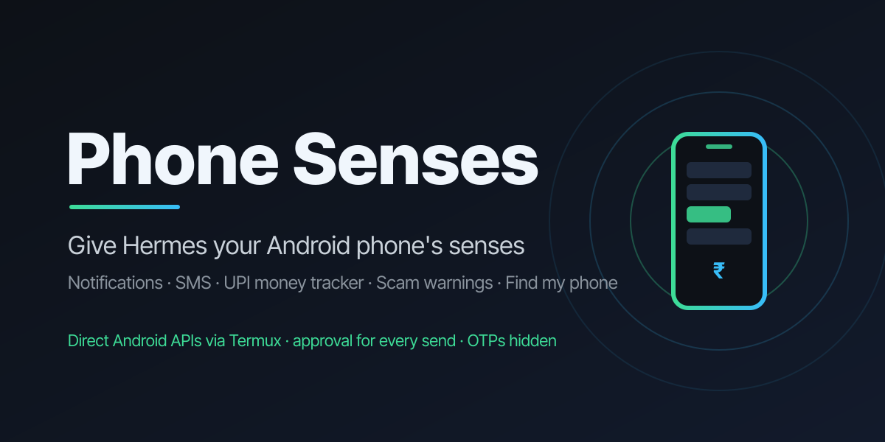
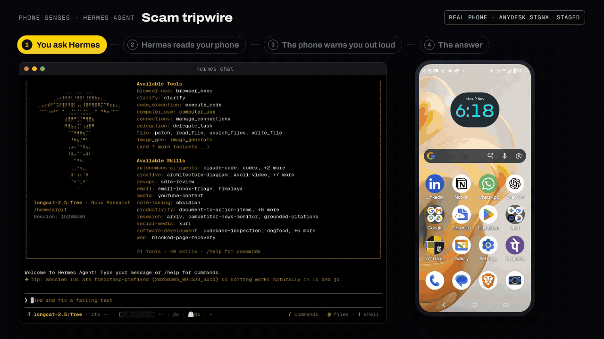
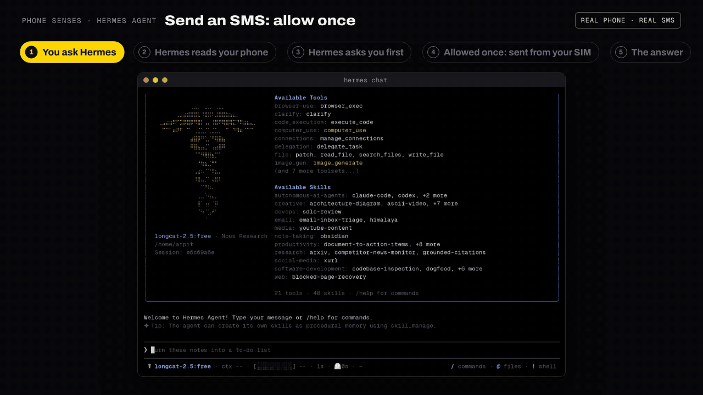

# Phone Senses

**Give Hermes Agent the senses of your own Android phone**: notifications, SMS, calls, battery,
location, bank and UPI money, bills, deliveries, scam warnings, a live scam tripwire and find my phone.
It talks to Android directly through Termux:API (no screen tapping), on your own phone and SIM, and
**Hermes asks you before it sends, calls, takes a photo or reveals a code**.

Full documentation, setup guide and the demo film: <https://github.com/LSUDOKO/Phone-Senses#readme> ·
website: <https://phone-senses.pages.dev>

## See it work (real Hermes sessions on a real phone)
Left: Hermes as it looked in the terminal. Right: the phone at the same moment.

More clips (money, UPI, scam check, OTP hidden, deny, watch rules, battery, find my phone) are in the
[main README](https://github.com/LSUDOKO/Phone-Senses#see-it-work).

## Install
1. **Phone:** install Termux and Termux:API from F-Droid, then in Termux:
   `pkg install -y python termux-api git`, clone this repository, run
   `python phone_helper/helper.py --pair` (prints a pairing code) and start the helper:
   `termux-wake-lock && python phone_helper/helper.py --host <phone Wi-Fi or Tailscale IP>`.
2. **Hermes:** `hermes plugins install phone-senses`, then in the plugin settings set `helper_url`
   to `http://<phone-ip>:8765` and paste the pairing code into `helper_token`.
3. Try `/phone` or ask "Anything important on my phone?"

No phone at hand? `python phone_helper/helper.py --mock` serves synthetic data on your laptop
(`--mock-scenario scam` plays a scam call in progress).

## Tools (26)
| Area | Tools |
|---|---|
| Read the phone | `phone_status`, `phone_notifications`, `phone_sms_list`, `phone_calls`, `phone_contacts`, `phone_location`, `phone_brief` |
| Act (asks first) | `phone_sms_send`, `phone_call`, `phone_photo`, `phone_otp_reveal` |
| Act (harmless) | `phone_ring`, `phone_speak`, `phone_clipboard` |
| Money from SMS | `phone_money_sync`, `phone_money_summary`, `phone_budget_set`, `phone_subscriptions`, `phone_bills` |
| Life admin | `phone_deliveries` |
| Safety | `phone_scam_check`, `phone_scam_guard` (scam tripwire) |
| Watch rules | `phone_watch_add`, `phone_watch_list`, `phone_watch_remove`, `phone_watch_check` (for Hermes cron) |

Also: a `pre_tool_call` approval hook, the `/phone` slash command and a bundled skill.

## Safety and disclosures
- **Network:** the plugin talks only to the phone helper URL you configure (LAN or Tailscale). No
  third-party services, no telemetry.
- **On the phone:** the repository's own helper (standard-library Python) runs in Termux, executes
  fixed `termux-*` commands (never a shell) and serves an HMAC-SHA256 signed API with a nonce
  replay cache, a ±60 s clock window and rate limits. The pairing secret is never sent.
- **Reads** notifications, SMS, call log, contacts, location and battery on your phone. One-time
  codes are masked in every result by default.
- **Approvals:** `phone_sms_send`, `phone_call`, `phone_photo` and `phone_otp_reveal` always go
  through Hermes's approval prompt; there is no auto-approve path, and unattended runs (cron, `-q`)
  are refused.
- **Stores** parsed transactions (amounts and merchants, never message text), budgets, watch rules
  and approved photos in the plugin's data directory.
- **Background process:** only the helper you start on the phone; nothing runs on the Hermes host.

MIT licensed · built by Arpit Singh, Hamirpur, for the Hermes Agent Plugin Hackathon.
